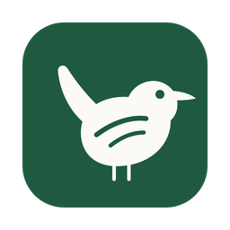
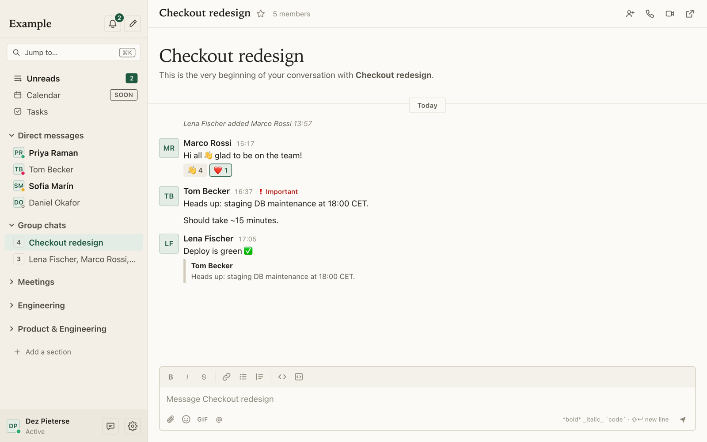

<h1 align="center">Wren</h1>

A fast, Slack-style Mac app for your Microsoft Teams chats.

<a href="https://github.com/dezluan/wren/releases/latest"><b>Download for macOS</b></a> · <a href="docs/it-setup.md">IT setup</a> · <a href="CHANGELOG.md">Release notes</a> · <a href="SECURITY.md">Security</a>

*Wren was called Nodal until version 0.5.0. Downloads up to 0.4.0 still carry the old name.*

Wren talks to Teams through Microsoft Graph, so everything you send shows up in Teams for your
colleagues. You just never have to open Teams yourself. It's a native Mac app written in Rust:
it starts quickly, stays light on memory, and works the way Slack does.

Wren is an independent app. It isn't made by or affiliated with Microsoft. Its mascot is a wren: small, quick, and much quieter than the alternatives.

## What you get

- **Slack-style layout:** direct messages, group chats, meetings and one section per team with
  its channels. Star conversations, collapse sections, or make your own sections and drag chats in.
- **Unreads** (⌘⇧A): every chat with new messages on one page, showing just what's new.
  Unread state stays in step with Teams, with a Dock badge and desktop notifications.
- **Threads** in a side panel, like Slack.
- **A composer with Slack muscle memory:** `*bold*`, `_italic_`, `~strike~`, `` `code` ``,
  `:shortcodes:`, @mentions, Enter to send, and drafts kept per conversation.
- **Images and GIFs:** paste a screenshot to send it. Paste a Giphy link to send the GIF, or pick
  from GIFs in your chats and your favourites. Click any image to see it large.
- **Reactions:** click to react, hover to see who reacted.
- **Tasks:** a simple to-do list in the sidebar. Turn any message into a task, and the task
  links back to it.
- **Calls:** the 📞 and 🎥 buttons start a Teams call with everyone in the chat (up to 20
  people). The call itself runs in Teams on the web or the Teams app, because Microsoft doesn't
  let other apps place calls.
- **⌘K** to jump to any chat, person or channel, and **⌘N** for a new message.
- **Glass or Classic look**, in light and dark, with several colour palettes.
- **Your company logo** next to the name at the top of the sidebar (Settings → General).
- **Accessibility** (Settings → Accessibility): text size (⌘+ / ⌘− / ⌘0), reduce motion, reduce
  transparency, increase contrast, underlined links and bolder keyboard focus. Each follows your
  Mac's own accessibility settings unless you change it. Buttons, dialogs and the main areas are
  labelled for VoiceOver.

**Coming soon:** your Outlook calendar, sending files (images already work), and syncing Tasks
with Microsoft To Do.

## Install

1. Download the `.dmg` from the
   [latest release](https://github.com/dezluan/wren/releases/latest). It runs on Apple Silicon
   and Intel Macs, and is tested on macOS 26 (Tahoe).
2. Open the DMG and drag **Wren** into **Applications**.
3. Open Wren. Because it isn't notarised by Apple yet, macOS blocks it the first time:
   1. In the warning, click **Done** (or **OK**).
   2. Open **System Settings → Privacy & Security**, scroll down to **Security**, and click
      **Open Anyway** next to the message about Wren.
   3. Confirm with your password or Touch ID. From then on, Wren opens normally.

   Prefer Terminal? `xattr -dr com.apple.quarantine /Applications/Wren.app` does the same.
4. macOS asks whether Wren may send notifications. Allow it to get new-message alerts.

**Updating:** download the new DMG and drag Wren into Applications again, replacing the old
copy. Your sign-in, settings, tasks and drafts are kept. After an update, macOS may ask whether
Wren can use its saved sign-in in your Keychain: choose **Always Allow**.

**Uninstalling:** quit Wren and drag it from Applications to the Bin. To remove everything it
stored, also delete `~/Library/Application Support/Wren`, `~/Library/Logs/Wren` and
`~/Library/WebKit/app.nodechat.node`, and the `app.nodechat.node` item in Keychain Access.

## Sign in

Wren signs in with your work Microsoft account, in your browser, with your usual MFA. It needs
an **app registration** in your organisation's Microsoft Entra ID, which your IT team sets up
once. Send them the [IT setup guide](docs/it-setup.md).

IT then gives you two values. The first time you open Wren, the login screen shows them under
**Advanced**:

1. Enter the **Tenant** (your organisation's domain, such as `contoso.com`, or its tenant ID)
   and the **Application (client) ID**.
2. If IT didn't approve channel reading, untick **Read Teams channels**. Chats and DMs still work.
3. Click **Sign in with Microsoft**, and pick your work account in the browser.

Wren remembers you after that. To sign out, open **Settings → Account**.

## Keyboard shortcuts

| Keys | Action |
| --- | --- |
| ⌘K / ⌘T | Jump to a conversation |
| ⌘N | New message |
| ⌘⇧A | Unreads |
| ⌥↑ / ⌥↓ | Previous / next conversation |
| ⌥⇧↑ / ⌥⇧↓ | Previous / next unread conversation |
| ⌘, | Settings |
| Esc | Close thread or dialog |
| Start typing | Focuses the composer |

## Privacy

There's no Wren server, and no telemetry or analytics. Wren connects to Microsoft for
sign-in and Teams, and to Giphy only to load GIFs, without your token or cookies. Your sign-in
is kept in the macOS Keychain, and messages are never written to disk (except tasks you make
from a message, which keep its text). The
[security overview](SECURITY.md) has the details.

## Known limitations

- You can't edit or delete your own messages from Wren yet. ↗ opens the chat in Teams for that.
- Channels don't show unread state yet, because Graph has no cheap way to read it.
- No "Seen" receipts: Graph only shares your own read position, not other people's.
- New messages are checked every few seconds rather than pushed instantly.
- Your sections and tasks stay on one Mac and aren't synced.

## Feedback

Found a bug or have an idea? In Wren, click 💬 next to Settings (or **Settings → Help &
feedback → Give feedback**). Wren opens a new issue on this repository in your browser, already
filled in with your note and your Wren and macOS versions, and you press **Create** there. You
need a GitHub account, and issues are public, so leave out anything confidential. You can also
[open an issue](https://github.com/dezluan/wren/issues) directly.

For problems, it helps to attach the log file: **Settings → Help & feedback → Show log file**.
The log holds no message text, names or tokens. For security issues, see [SECURITY.md](SECURITY.md).

## Licence

Wren is free to download and use. © 2026 Dez-Luan Pieterse. See [LICENSE](LICENSE).

Microsoft, Microsoft Teams and Microsoft Entra are trademarks of the Microsoft group of companies.
